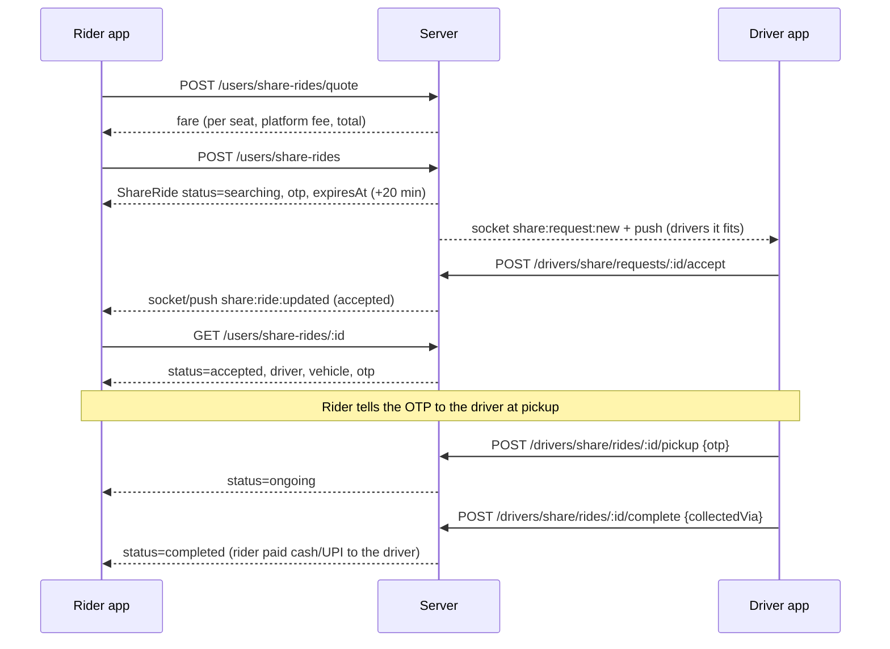
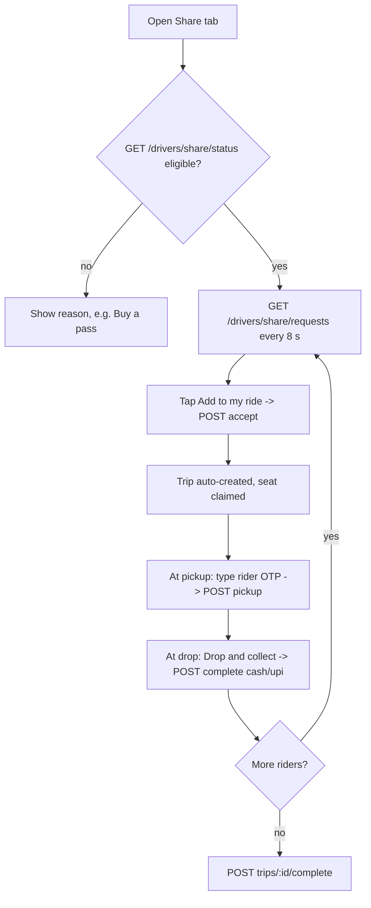

# Share Ride (Car Pooling), Flutter integration guide

For the Flutter developers of the **Roozgar Cab rider app** and **driver app** (the owner role lives inside the
driver app). Everything here is **live in the backend code**; the JSON examples were captured from the real running
API, not written by hand. The web apps already use all of it, so the web code is a working reference:

| Role | Web reference screen |
|---|---|
| Rider | `frontend/src/modules/user/pages/shareRide/ShareRideHome.jsx`, `ShareRideTrack.jsx` |
| Driver | `frontend/src/modules/driver/pages/ShareRides.jsx` |
| Owner | `frontend/src/modules/driver/pages/OwnerShareRides.jsx` |
| Admin | read-only web monitor only, **nothing to build in Flutter** |

Backend: `Backend/src/modules/taxi/shareRide/`. Engineering spec: `docs/share-ride.md`. Driver multi-vehicle:
`docs/driver-multi-vehicle.md`.

---

## 0. TL;DR, what you have to build

1. **Rider app**: a "Car Pooling" entry that opens a new Share Ride flow: pick pickup/drop + seats, see the fare,
   request, wait, show OTP + driver, track, done. 6 endpoints, 1 realtime event, 5 push types.
2. **Driver app**: a "Share" area: list of requests on my route, **Add to my ride**, enter rider's OTP, **Drop &
   collect** (cash/UPI), earnings. 10 endpoints.
3. **Owner (in driver app)**: overview + earnings, per-driver on/off switch, create a trip for a fleet driver, lists.
   6 endpoints. No realtime for owners: poll.
4. **Stop using** the old admin-managed pooling screens/endpoints (`/users/pooling/*`, `pooling_driver` role,
   Shared Taxi). They still respond but are no longer the product (section 13).
5. Nothing changes in normal rides, dispatch, wallet or subscription screens.

---

## 1. The idea in plain words

**Share Ride** lets riders going the same way share a car and pay less. It is **not** run by the admin. A rider
asks for 1-4 seats; a **driver (or an owner's fleet driver) adds that request to the ride/trip they are already
doing**, picks the rider up with an OTP, drops them, and collects cash/UPI. The platform only keeps a small
platform fee. The admin only watches.

Two objects:

* **ShareRide**: *one rider's* seats (a request). Has a fare, an OTP, a status.
* **ShareTrip**: *one run of a driver's car*. Holds up to (capacity - 1) seats; several ShareRides attach to it.
  One active trip per driver, one active ShareRide per rider (the server enforces both).

A request becomes visible to a driver when it is **on the driver's way**: the rider's pickup *and* drop are within
**4 km** of the straight line of the driver's trip (or of the normal ride they are on), going the same direction.
A driver with nothing running sees requests within **6 km** of them.

---

## 2. Integration basics

| Thing | Value |
|---|---|
| API base | `https://roozgarcab.com/api/v1` (the web app uses the same) |
| Auth | `Authorization: Bearer <JWT>`, the same token your existing login gives (rider = role `user`, driver = `driver`, owner = `owner`). A token of the wrong role gets **403** |
| Format | JSON in and out |
| Socket | Socket.IO at `https://roozgarcab.com`, `auth: {token}`; the same connection the ride flow uses |
| Push | FCM. Register tokens with the existing `POST /users/fcm-token` (rider) and `POST /drivers/fcm-token` (driver); body `{ "token": "...", "platform": "android" \| "ios" }` |

### Response envelope

```json
{ "success": true,  "message": "", "data": { } }
{ "success": false, "message": "Wrong OTP", "details": null }
{ "success": false, "message": "Share rides are for car drivers", "code": "SHARE_NOT_ALLOWED", "details": null }
{ "success": false, "message": "Validation failed", "errors": ["..."] }
```

Always show `message` to the user as is (messages are written for end users). `code` appears only for a few
errors (`SHARE_NOT_ALLOWED`, `SUBSCRIPTION_REQUIRED`).

### Conventions

* **Locations** are sent and received as **`{ "lat": 22.7183, "lng": 75.8553, "address": "Rajwada" }`**. Never
  GeoJSON arrays. (The web code keeps `[lng, lat]` internally; do not copy that.)
* **Money** is rupees. `fare`, `perSeat`, `subtotal`, `platformFee` are whole rupees. Settlement numbers
  (`commissionWaived`, `driverEarnings`, ...) can have decimals: parse as `num`/`double`.
* **Time** is ISO-8601 UTC (`"2026-10-31T13:10:44.825Z"`). Use `expiresAt` for countdowns, and `.toLocal()`.
* **IDs** are 24-char hex strings.
* **Rate limits** (both return **429** `{success:false,message}`): quote 60 per 5 min per IP; creating a request
  10 per 10 min per rider. Debounce quote calls (e.g. 400 ms after the user stops changing seats/places).

---

## 3. Flows

### 3.1 Rider



### 3.2 Driver



A driver can attach riders to the normal ride they are on **or** to a share trip; the server chooses the route
automatically (section 7).

### 3.3 Owner

Owner sees overview + earnings, switches share rides on/off per fleet driver, creates a trip for a fleet driver
(origin/destination), and lists trips/rides. The fleet driver then sees matching riders in *their* app like any
driver.

---

## 4. Status machines

**ShareRide.status**

```
searching --driver accepts--> accepted --OTP--> ongoing --complete--> completed
    |  \                          |  \
    |   expire (20 min)->expired  |   driver "hand back" -> searching (new OTP, +10 min)
    |                             \-- rider cancels -> cancelled
    \-- rider cancels -> cancelled
(system also cancels: accepted > 6 h, ongoing > 12 h  ->  cancelled, cancelledBy "system")
```

**ShareTrip.status**: `open` (nobody on board yet) -> `running` (first pickup done) -> `completed` / `cancelled`.

### What each role may do in each status

| ShareRide status | Rider | Driver |
|---|---|---|
| `searching` | cancel | accept (if it fits) |
| `accepted` | cancel, see OTP + driver | verify OTP (pickup), hand back |
| `ongoing` | read only ("pay the driver cash/UPI") | complete (drop & collect) |
| `completed` / `cancelled` / `expired` | history, "request again" | history |

---

## 5. Data models

### 5.1 ShareRide (what the app receives)

```json
{
  "id": "6ae5e4249662309d91e38310",
  "status": "accepted",
  "seats": 2,
  "distanceKm": 20,
  "fare": 391,
  "fareBreakdown": { "perSeat": 186, "subtotal": 372, "platformFee": 19, "discountPercent": 30, "tariffName": "Sedan" },
  "pickup": { "address": "Rajwada", "lat": 22.7183, "lng": 75.8553 },
  "drop":   { "address": "Dewas",   "lat": 22.9676, "lng": 76.0534 },
  "tripId": "6ae5e4259662309d91e38311",
  "expiresAt": "2026-10-31T13:10:44.825Z",
  "acceptedAt": "2026-10-31T12:50:45.107Z",
  "pickedUpAt": null, "completedAt": null, "cancelledAt": null,
  "cancelledBy": "", "cancelReason": "", "collectedVia": "",
  "createdAt": "2026-10-31T12:50:44.831Z",
  "driver":  { "id": "...", "name": "Driver 1", "phone": "9100000011", "photo": "" },
  "vehicle": { "type": "car", "name": "", "number": "MH12AB1011", "color": "white" },
  "otp": "9125"
}
```

Which fields appear depends on **who is asking**:

| Field | Rider | Driver (before accept) | Driver (after accept) |
|---|---|---|---|
| `otp` | **yes** (only the rider) | no | **no** (driver must ask the rider) |
| `passenger` | no | `{name}` first name only, **no phone** | `{name, phone}` full |
| `driver`, `vehicle` | after accepted | null | yes |
| `settlement` | no | no | yes (see 5.3) |
| `fit` (extra) | no | yes, on request-list items | no |

`driver` / `vehicle` are `null` while `searching`. `cancelledBy` is `""`, `"user"`, `"driver"` or `"system"`.
`collectedVia` is `""`, `"cash"` or `"upi"`.

### 5.2 ShareTrip

```json
{
  "id": "6ae5e4259662309d91e38311",
  "status": "open",
  "driverId": "6ae5e4249662309d91e38308",
  "ownerId": null,
  "createdBy": "driver",
  "vehicle": { "type": "car", "name": "", "number": "MH12AB1011", "color": "white" },
  "origin":      { "address": "", "lat": 22.7183, "lng": 75.8553 },
  "destination": { "address": "Dewas", "lat": 22.9676, "lng": 76.0534 },
  "routeDistanceKm": 44.7,
  "baseRideId": null,
  "seatsTotal": 3, "seatsTaken": 2, "seatsFree": 1,
  "startedAt": null, "completedAt": null, "createdAt": "2026-10-31T12:50:45.119Z",
  "stats": { "ridersCompleted": 0, "gross": 0, "platformFee": 0, "commission": 0, "driverEarnings": 0 },
  "riders": [ /* ShareRide, driver view, accepted + ongoing only */ ]
}
```

`createdBy`: `"driver"` (made automatically when they added a rider) or `"owner"`. `baseRideId` is set when the
trip rides along with the driver's normal ride. `seatsTotal` = vehicle capacity - 1 (driver), minus 1 more when a
normal ride is on board, max 6.

### 5.3 Settlement (after a ride completes)

```json
{ "platformFee": 19, "commission": 0, "commissionWaived": 74.4, "takenFromDriver": 19, "driverEarnings": 372 }
```

Stored on the ride as `settlement` with `settledAt`, `subscriptionId`, and `walletStatus` (`none` | `settled` |
`pending`; `pending` means the wallet debit did not go through and the admin sees it).

---

## 6. Endpoint reference

All paths are relative to the API base. 4xx messages listed are the exact strings the server sends.

### 6.1 Rider (`user` token)

#### `POST /users/share-rides/quote`
Price a request. Call it whenever pickup, drop or seats change.
```json
// request
{ "pickup": { "lat": 22.7183, "lng": 75.8553, "address": "Rajwada" },
  "drop":   { "lat": 22.9676, "lng": 76.0534, "address": "Dewas" }, "seats": 2 }
// 200 available (example from a test tariff)
{ "success": true, "message": "", "data": { "available": true, "distanceKm": 20, "seats": 2,
  "perSeat": 186, "subtotal": 372, "platformFee": 19, "total": 391, "discountPercent": 30, "tariffName": "Mini" } }
// 200 not possible: show data.reason, disable the button
{ "success": true, "message": "", "data": { "available": false, "reason": "Share rides are not available in this area yet" } }
```
`reason` values: `Share rides are not available in this area yet`, `Pickup and drop are too close for a shared ride`,
`This trip is too long for a shared ride`. `seats` outside 1-4 is clamped here. Errors: 400
`A valid pickup location is required` (same for drop), 429 rate limit.

#### `POST /users/share-rides`  (create the request)
Same body as quote. **The server recomputes the fare; never send one.** `201`, `message: "Looking for a driver"`,
`data` = ShareRide (`status: "searching"`, with `otp`, `expiresAt` = now + 20 min).
Errors: 400 `You can book 1 to 4 seats`; 400 bad location; **409 `You already have a share ride in progress`**
(open the existing one instead: `GET /users/share-rides?status=active`); **422** with the quote `reason` (not
available); 429 `Too many ride requests. Please try again later.`

#### `GET /users/share-rides?status=active|history`
`data` = array of ShareRide (newest first, max 50). `active` = searching/accepted/ongoing, `history` = completed/
cancelled/expired. Use `active` on app start to resume a ride in progress.

#### `GET /users/share-rides/:id`
`data` = ShareRide (includes `otp`, `driver`, `vehicle` once accepted). 404 `Share ride not found` if it is not yours.
This is the tracking call: poll every **8 s** while the screen is visible, and refetch on the socket/push event.
```json
{ "status": "accepted", "otp": "9125",
  "driver":  { "id": "...", "name": "Driver 1", "phone": "9100000011", "photo": "" },
  "vehicle": { "type": "car", "name": "", "number": "MH12AB1011", "color": "white" } }
```

#### `POST /users/share-rides/:id/cancel`
Body `{ "reason": "optional text" }`. Allowed in `searching` and `accepted`. `200`, message `Ride cancelled`,
`data` = ShareRide (`status: "cancelled"`, `cancelledBy: "user"`). Errors: 409 `This ride can no longer be cancelled`
(it is `ongoing` or finished), 404.

### 6.2 Driver (`driver` token)

#### `GET /drivers/share/status`
```json
{ "data": { "eligible": true, "reason": "", "enabled": true, "hasNormalRide": false, "trip": null } }
```
`eligible:false` + `reason` (show it): `Your account is waiting for approval`, `Share rides are switched off for you by
your owner`, `Share rides are for car drivers`, `Buy a pass to take share rides`. `trip` is the active ShareTrip (no
riders) or null. `enabled:false` means the owner switched it off.

#### `GET /drivers/share/requests`
```json
{ "data": { "eligible": true, "reason": "", "source": "idle", "seatsFree": 3, "corridorKm": 4,
  "requests": [ { "id": "...", "status": "searching", "seats": 2, "fare": 391, "fareBreakdown": {"...": "..."},
     "pickup": {"address":"Rajwada","lat":22.7183,"lng":75.8553}, "drop": {"address":"Dewas","lat":22.9676,"lng":76.0534},
     "passenger": { "name": "Asha" }, "expiresAt": "...", "fit": { "pickupAwayKm": 0 } } ] } }
```
* `source`: `trip` (route = my share trip), `ride` (route = my current normal ride), `idle` (nothing running: requests
  within 6 km of me), `none` (not eligible).
* `fit`: for `trip`/`ride` -> `{ "fits": true, "pickupOffKm": 0.9, "dropOffKm": 0.1, "forward": true }` (show "0.9 km off your
  route"); for `idle` -> `{ "pickupAwayKm": 1.4 }`.
* Poll every 8 s on the requests tab; also refetch on `share:request:new`. Requests I handed back never reappear.

#### `POST /drivers/share/requests/:rideId/accept`  ("Add to my ride")
Body `{}` (optional `{ "tripId": "..." }`). `200`, message `Added to your trip`:
`data = { "ride": ShareRide (driver view, now with passenger phone), "trip": ShareTrip with riders[] }`.
The trip is created automatically if you have none (from your normal ride, or from your location to the rider's drop).
Errors: 403 `Share rides are for car drivers` (code `SHARE_NOT_ALLOWED`); 403 **`Buy a pass to take share rides`
(code `SUBSCRIPTION_REQUIRED`)**; 403 `Go online to take share rides`; 409 `This request is no longer available`;
409 `Another driver just took this request`; 409 `Not enough free seats on your trip`; 409 `This rider is not on your route`
(or `...on the route of your current ride`); 409 `You handed this rider back earlier`; 409 `This vehicle has no free seat to share`.
When two drivers tap at once exactly one wins; the loser gets a 409, refresh the list.

#### `POST /drivers/share/rides/:rideId/pickup`
Body `{ "otp": "9125" }` (4 digits). `200`, message `Rider picked up`, `data` = ShareRide (`ongoing`). Errors: 400 `Wrong OTP`;
**429 `Too many wrong OTPs. Ask the rider to cancel and book again`** (locked after 5 wrong tries); 409 `This rider is not
waiting for pickup`.

#### `POST /drivers/share/rides/:rideId/complete`  ("Drop & collect")
Body `{ "collectedVia": "cash" | "upi" }` (default cash). Call it **after** the driver has been paid. Idempotent: a second
call gets 409. `200`, message `Ride completed`:
```json
{ "data": { "ride": { "status": "completed", "collectedVia": "cash", "completedAt": "...",
    "settlement": { "settledAt": "...", "platformFee": 19, "commission": 0, "commissionWaived": 74.4,
                    "driverEarnings": 372, "subscriptionId": "...", "walletStatus": "settled" } },
  "settlement": { "platformFee": 19, "commission": 0, "commissionWaived": 74.4, "takenFromDriver": 19, "driverEarnings": 372 } } }
```
Show the driver `settlement.driverEarnings` as "You earned" and `platformFee` as "Platform fee". `settlement` can be
`null` if the settlement step failed after the ride completed (the ride is still completed; tell the driver "being
processed"). Error: 409 `This ride is not in progress`.

#### `POST /drivers/share/rides/:rideId/release`
Hand an `accepted` rider back (before pickup). `200`, message `Rider handed back`, `data` = ShareRide (`searching` again,
new OTP). The rider is told and the request is re-offered to others (not to you). Error 409 `This rider cannot be handed back now`.

#### `GET /drivers/share/trip`
`data` = the active ShareTrip with `riders[]` (accepted + ongoing) or `null`. This drives the "My trip" tab.

#### `POST /drivers/share/trips/:id/complete` and `/cancel`
Close the trip. 409 `N rider(s) is/are still on this trip` if anyone is accepted/ongoing. 404 `Trip not found`.

#### `GET /drivers/share/earnings?from=ISO&to=ISO`
```json
{ "data": { "rides": 1, "seats": 2, "gross": 391, "platformFee": 19, "commission": 0, "commissionWaived": 74.4,
  "driverEarnings": 372, "recent": [ /* last 20 completed ShareRides, driver view */ ] } }
```

### 6.3 Owner (`owner` token, inside the driver app)

| Call | Body / query | `data` |
|---|---|---|
| `GET /drivers/fleet/share/overview` | | `{ totals:{rides,seats,gross,platformFee,commission,commissionWaived,driverEarnings,ownerEarnings}, activeTrips, ridersOnBoard, drivers:[{id,name,phone,vehicleType,vehicleNumber,isOnline,shareEnabled,rides,gross,earnings}] }` |
| `GET /drivers/fleet/share/trips` | `?status=active` | array of ShareTrip, each with `driver:{_id,name,phone}` |
| `GET /drivers/fleet/share/rides` | `?status=&page=&limit=` | `{ results:[ShareRide], paginator:{current_page,per_page,total,last_page} }` |
| `POST /drivers/fleet/share/trips` | `{ driverId, origin:{lat,lng,address}, destination:{lat,lng,address}, seatsTotal? }` | ShareTrip (201 `Trip created`) |
| `POST /drivers/fleet/share/trips/:id/cancel` | | ShareTrip |
| `PATCH /drivers/fleet/share/drivers/:driverId` | `{ "enabled": false }` | `{ id, shareEnabled }` |

Errors: 404 `This driver is not in your fleet`; 409 `Share rides are for car drivers`; 409 `This driver already has a share
trip running`; 409 `N rider(s) ... still on this trip` (cancel); 400 bad place. `ownerEarnings` equals the fleet's
`driverEarnings` (the owner view of fleet drivers' earnings, same rule as the existing owner dashboard).

---

## 7. Matching rules (so the UI can explain itself)

* A request fits a route when rider **pickup and drop are each within 4 km** of the straight line origin -> destination
  and the drop comes after the pickup along it. Opposite direction never fits.
* The driver's route is, in order: their **active share trip**; their **normal ride** (accepted/ongoing, pickup -> drop);
  otherwise they are *idle* and see requests within **6 km** of their location (their location must be known).
* Seats: a request needs `seats <= seatsFree`. A trip made from a normal ride keeps one seat for that rider.
* New requests are pushed to at most 30 nearby/on-route drivers who are car drivers with an active pass and share rides on.
* An unanswered request expires after **20 min**. A handed-back request lives 10 more minutes.
* A driver's empty auto-made trip is closed by the server when its last rider leaves.

---

## 8. Realtime and push

### Socket.IO
Connect once with `auth: { token }` (you already do for rides). The server **auto-joins** the room `user:<id>` or
`driver:<id>`; you do not emit anything to join. Events:

| Event | Room | Payload | When |
|---|---|---|---|
| `share:request:new` | driver | `{ rideId }` | a request that fits this driver was created/handed back |
| `share:ride:updated` | rider **and** driver | `{ rideId, status, type }` | the ride changed (`type` = `share_accepted`, `share_started`, `share_completed`, `share_released`, `share_cancelled`) |

Treat the payload as a *hint*: on any event, refetch the relevant GET. Owners have **no** socket room: poll.

### FCM push (standard notification + data)
`data.click_action = "FLUTTER_NOTIFICATION_CLICK"`, `data.type`, `data.rideId` (all strings).

| `data.type` | To | Title / body |
|---|---|---|
| `share_request` | drivers | `Share ride request` / `2 seats on your way, Rs 391` |
| `share_accepted` | rider | `Share ride confirmed` / `<driver> is coming to pick you up. Share your OTP at pickup.` |
| `share_started` | rider | `Share ride started` / `Your ride has started. Have a safe trip!` |
| `share_completed` | rider | `Ride completed` / `You have reached your drop. Thanks for sharing the ride!` |
| `share_released` | rider | `Looking for another driver` / `Your driver could not take this ride. We are finding you another one.` |
| `share_cancelled` | driver | `Rider cancelled` / `The rider cancelled this share ride.` |

On tap: rider -> open tracking for `rideId`; driver -> open the Share screen (requests tab for `share_request`, My trip
otherwise).

### Cadence
Rider tracking: poll 8 s (+ socket). Driver requests / trip: poll 8 s (+ socket). Stop polling when the screen is not
visible; push covers the background.

---

## 9. Screens

### Rider app
1. **Share Ride home**: pickup + drop pickers (reuse your existing location picker), seats stepper 1-4, live quote card
   (per seat, platform fee, total, "30% cheaper than riding alone"), `Request share ride`, and "My share rides"
   (history). On open call `GET ...?status=active`: if there is one, jump to its tracking screen.
2. **Tracking** (one screen, content by status):
   * `searching`: "Finding a driver", countdown to `expiresAt`, Cancel.
   * `accepted`: **OTP in large type** ("Share this OTP with your driver at pickup"), driver name + call button,
     vehicle number/colour, fare, Cancel.
   * `ongoing`: "Trip in progress", route, fare: **"Pay the driver in cash or UPI"** (no in-app payment).
   * `completed`: thank-you + "Fare paid Rs X".
   * `cancelled` / `expired`: message (`cancelReason` if any) + "Request again".
3. Entry point: the home **Car Pooling** tile (a module with `service_type: "pooling"`) opens screen 1.

### Driver app
A **Share** screen with three tabs (the web page is the reference):
1. **Requests**: header from `source` ("Riders on your route" / "along your current ride" / "near you") + `seatsFree`;
   cards: pickup -> drop, seats, fare, "X km off your route"; button **Add to my ride**. If `eligible:false` show `reason`
   (and a button to the pass/subscription screen when it mentions a pass).
2. **My trip**: trip header (origin -> destination, seats taken/total) and each rider: name + tap-to-call phone, pickup/drop,
   seats, fare. `accepted` -> 4-digit OTP field + **Start ride**, and **Hand back** (confirm). `ongoing` -> **Drop & collect**
   sheet (fare, Cash/UPI, confirm), then show the settlement ("Platform fee", "Waived by your pass" when
   `commissionWaived > 0`, **"You earned"**). Bottom: **Close trip** / **Cancel trip** (confirm; show the 409 text).
3. **Earnings**: rides, gross, platform fee, commission waived, big **Your earnings**, recent list.

Entry: a "Share" tab in the driver bottom bar and a shortcut on the driver home.

### Owner (driver app, owner role)
Overview cards (rides, gross, platform fee, **your earnings**, active trips, riders on board); fleet drivers list with an
on/off switch (revert and toast on error; only car drivers can take share rides); "Create trip" form; active trips with
Cancel; rides list with filter + pages.

---

## 10. Money, step by step

### 10.1 What the rider pays
Computed **only on the server** from the admin's normal city tariff at the pickup point, for the cheapest car-class vehicle:

```
solo      = base_price + max(0, km - base_distance) * price_per_distance
perSeat   = round(solo * (1 - 30%))                     // sharing discount, a constant
subtotal  = perSeat * seats
platformFee = percentage ? round(subtotal * fee% )  : fee      // fixed fee is charged once per ride, not per seat
fare (total) = subtotal + platformFee
```
Example: base 50 (2 km), Rs 12/km, 20 km, 2 seats, 5% fee -> solo 266 -> perSeat 186 -> subtotal 372 -> fee 19 -> **fare 391**.
Distance is the routed distance (Google/OSRM), or straight line x 1.3 if routing fails.

### 10.2 How the rider pays
**Cash or UPI to the driver at the drop.** There is no in-app payment for Share Ride. The driver taps
"Drop & collect" and chooses Cash or UPI.

### 10.3 What happens to the money (on `complete`, once)
| Part | Goes to | Rule |
|---|---|---|
| Platform fee (`fareBreakdown.platformFee`) | **Roozgar Cab** | always |
| Trip commission | Roozgar Cab | **waived (0)** while the driver has an **active subscription pass** covering that moment; otherwise the normal admin commission % on `fare - platformFee` |
| Everything else | **the driver** | `driverEarnings = fare - platformFee - commission` |

Because the driver already holds the cash, the platform's share is **debited from the driver's wallet**:
`takenFromDriver = platformFee + commission` (a `commission_deduction` transaction with `metadata.shareRideId`; it shows in
the existing wallet history). With a pass, `takenFromDriver` is just the platform fee.

Examples (fare 391, fee 19):

| Driver has a covering pass | commission | takenFromDriver | driverEarnings |
|---|---|---|---|
| yes | 0 (waived, recorded in `commissionWaived`) | 19 | **372** |
| no (10% commission) | 37.2 | 56.2 | **334.8** |

### 10.4 Owner
For a fleet driver the earnings count as the **owner's** earnings in the owner overview (`ownerEarnings`), the same rule
the existing owner dashboard uses for normal rides. The driver's wallet still takes the platform fee debit.

### 10.5 What to display
* Rider: only `fare` and its breakdown (per seat x seats, platform fee). Never any commission.
* Driver: after each drop `driverEarnings`, `platformFee`, and "waived by your pass" if `commissionWaived > 0`. Earnings
  tab uses `GET /drivers/share/earnings`.
* Owner: `totals` and `drivers[].earnings`.
* Rounding: show rupees with up to 2 decimals for settlement values; whole rupees for fares.

---

## 11. Rules and edge cases (QA table)

| Case | Behaviour |
|---|---|
| Rider already has an active share ride | create -> 409; resume it |
| Request not accepted in 20 min | becomes `expired` (done lazily when read); rider can ask again |
| Two drivers accept at once | one 200, the other 409; no seat is lost |
| Rider cancels after accept | seat freed, driver told (`share_cancelled`) |
| Driver hands back | ride -> `searching`, new OTP, hidden from that driver, +10 min |
| Driver types 5 wrong OTPs | 429, locked; rider must cancel and book again |
| Complete called twice | second -> 409, nothing is charged twice |
| Driver vanishes (accepted > 6 h / ongoing > 12 h) | server cancels (`cancelledBy: "system"`, `cancelReason: "Timed out"`) |
| Driver offline with nothing running | accept -> 403 `Go online to take share rides` |
| Driver has no active pass | accept -> 403 `SUBSCRIPTION_REQUIRED`; requests list shows `eligible:false` |
| Bike/auto driver | `eligible:false`, `Share rides are for car drivers` |
| Driver with several vehicles | the **active** vehicle must be a car (see section 13) |
| Owner switched the driver off | `eligible:false`, `... switched off for you by your owner` |
| Seats > free seats | request is not listed; accept -> 409 |
| Driver on a normal ride | still gets normal-ride offers (dispatch is unchanged); they may decline |

---

## 12. Dart reference snippets

```dart
enum ShareRideStatus { searching, accepted, ongoing, completed, cancelled, expired }
ShareRideStatus statusFrom(String s) =>
    ShareRideStatus.values.firstWhere((e) => e.name == s, orElse: () => ShareRideStatus.searching);

class Place {
  final String address; final double lat; final double lng;
  Place({required this.address, required this.lat, required this.lng});
  factory Place.fromJson(Map<String, dynamic> j) =>
      Place(address: j['address'] ?? '', lat: (j['lat'] as num).toDouble(), lng: (j['lng'] as num).toDouble());
  Map<String, dynamic> toJson() => {'address': address, 'lat': lat, 'lng': lng};
}

class ShareRide {
  final String id; final ShareRideStatus status; final int seats; final num fare;
  final Place pickup, drop; final DateTime expiresAt; final String? otp;
  final Map<String, dynamic>? driver, vehicle, settlement, passenger;
  ShareRide.fromJson(Map<String, dynamic> j)
      : id = j['id'], status = statusFrom(j['status']), seats = j['seats'], fare = j['fare'],
        pickup = Place.fromJson(j['pickup']), drop = Place.fromJson(j['drop']),
        expiresAt = DateTime.parse(j['expiresAt']).toLocal(), otp = j['otp'],
        driver = j['driver'], vehicle = j['vehicle'], settlement = j['settlement'], passenger = j['passenger'];
}

class ShareApi {
  ShareApi(this.dio); final Dio dio;           // dio already has baseUrl + Bearer interceptor
  T _data<T>(Response r) => r.data['data'] as T;

  Future<Map<String, dynamic>> quote(Place p, Place d, int seats) async =>
      _data(await dio.post('/users/share-rides/quote', data: {'pickup': p.toJson(), 'drop': d.toJson(), 'seats': seats}));
  Future<ShareRide> create(Place p, Place d, int seats) async =>
      ShareRide.fromJson(_data(await dio.post('/users/share-rides', data: {'pickup': p.toJson(), 'drop': d.toJson(), 'seats': seats})));
  Future<ShareRide> get(String id) async => ShareRide.fromJson(_data(await dio.get('/users/share-rides/$id')));
  Future<List<ShareRide>> mine({bool history = false}) async =>
      (_data<List>(await dio.get('/users/share-rides', queryParameters: {'status': history ? 'history' : 'active'})))
          .map((e) => ShareRide.fromJson(e)).toList();
  Future<ShareRide> cancel(String id) async =>
      ShareRide.fromJson(_data(await dio.post('/users/share-rides/$id/cancel', data: {})));
}

// Error text: DioException e -> (e.response?.data?['message'] ?? 'Something went wrong').toString()

// Tracking: poll + socket. Cancel the timer in dispose().
// final t = Timer.periodic(const Duration(seconds: 8), (_) => refresh());
// socket.on('share:ride:updated', (_) => refresh());
```

Socket (package `socket_io_client`):
```dart
final socket = io('https://roozgarcab.com', OptionBuilder().setTransports(['websocket']).setAuth({'token': jwt}).build());
socket.on('share:request:new', (_) => refreshRequests());   // driver
socket.on('share:ride:updated', (_) => refreshRide());      // rider and driver
```

---

## 13. Impact on the existing Flutter apps

1. **Car Pooling tile / Shared Taxi.** The tile must open the new Share Ride flow. The old screens that call
   `/users/pooling/*` (search routes, seats, Razorpay booking) and the Shared Taxi pages belong to the old admin-run
   fixed-route pooling. The backend still answers them but the admin no longer manages routes/vehicles, so they will be
   empty: **hide them**.
2. **`pooling_driver` role and `/drivers/pooling/*`, `/drivers/fleet/pooling-vehicles`** (old pooling driver onboarding and
   owner pooling vehicles): not part of Share Ride. Hide the "Pooling driver" signup and the owner "Pooling vehicles" tab;
   owners use the new Share Rides screen instead.
3. **Driver multi-vehicle** (separate feature, `docs/driver-multi-vehicle.md`): a driver can hold several vehicles but only
   the **active** one receives bookings. Share Ride needs the active vehicle to be a **car**; a bike driver sees
   `eligible:false`. If your Vehicle Details screen is not updated yet, this is the same release: `GET /drivers/vehicles`,
   add -> admin approval, switch active.
4. **Normal rides, dispatch, wallet screens and subscriptions: unchanged.** Share Ride adds `commission_deduction`
   wallet entries (description `Platform fee deducted for share ride` or `Commission and platform fee deducted for share
   ride`, with `metadata.shareRideId`); your existing wallet history already lists them.
5. **FCM**: make sure the rider and driver tokens are registered (section 2) and that tapping a push with
   `data.type` starting with `share_` routes to the right screen.
6. **Known server-side issue (not Share Ride):** completed *normal* rides are currently not being settled on the live
   server (driver earnings/commission for normal rides read 0). Do not "fix" this in the app: it is a backend issue,
   reported to the backend owner and still pending, and it does not affect Share Ride.

---

## 14. Test it

**Prerequisites** (there is no demo data on purpose): a rider; a driver with `vehicleType: car`, approved, online with a
known location, and an **active subscription pass**; both inside a zone that has a normal car tariff.

Quick API walk-through (replace tokens/ids):
```bash
B=https://roozgarcab.com/api/v1
# rider: quote and request
curl -s -X POST $B/users/share-rides/quote -H "Authorization: Bearer $RIDER" -H 'Content-Type: application/json' \
  -d '{"pickup":{"lat":22.7183,"lng":75.8553,"address":"Rajwada"},"drop":{"lat":22.9676,"lng":76.0534,"address":"Dewas"},"seats":1}'
curl -s -X POST $B/users/share-rides -H "Authorization: Bearer $RIDER" -H 'Content-Type: application/json' -d '<same body>'
# driver: see it, add it
curl -s $B/drivers/share/requests -H "Authorization: Bearer $DRIVER"
curl -s -X POST $B/drivers/share/requests/$RIDE_ID/accept -H "Authorization: Bearer $DRIVER" -H 'Content-Type: application/json' -d '{}'
# rider reads the OTP, driver starts and finishes
curl -s $B/users/share-rides/$RIDE_ID -H "Authorization: Bearer $RIDER"
curl -s -X POST $B/drivers/share/rides/$RIDE_ID/pickup   -H "Authorization: Bearer $DRIVER" -H 'Content-Type: application/json' -d '{"otp":"1234"}'
curl -s -X POST $B/drivers/share/rides/$RIDE_ID/complete -H "Authorization: Bearer $DRIVER" -H 'Content-Type: application/json' -d '{"collectedVia":"cash"}'
```

Checklist: quote unavailable outside zones; second request while one is active -> 409; accept race (two devices);
wrong OTP then right OTP; 5 wrong OTPs -> 429; rider cancel in `searching` and `accepted` (not `ongoing`); hand back;
complete shows the right earning with and without a pass; owner switch turns the driver's `eligible` off; push + socket
refresh the rider screen; app restart resumes the active ride.

The backend ships two automated tests that mirror these rules: `Backend/scripts/testShareRide.mjs` (rules) and
`Backend/scripts/testShareRideHttp.mjs` (HTTP, auth, roles, read-only admin, rate limit).

---

## 15. Constants (server)

| Constant | Value |
|---|---|
| Corridor (pickup and drop off the route) | 4 km |
| Idle radius | 6 km |
| Seats per request | 1-4 |
| Request lifetime | 20 min (handed-back: 10 min) |
| Sharing discount | 30% |
| OTP | 4 digits, locked after 5 wrong tries |
| Auto-cancel stuck rides | accepted > 6 h, ongoing > 12 h |
| Drivers notified per request | max 30 |
| Trip length for a quote | 1 to 800 km |
| Quote rate limit | 60 / 5 min / IP |
| Create rate limit | 10 / 10 min / rider |

These are code constants, not admin settings. Ask the backend owner to change one.

---

## 16. Not in this version

Online payment for Share Ride, rider rating, in-trip chat, scheduled (future-time) share rides, and push/socket for
owners. Admin is a read-only web page.
